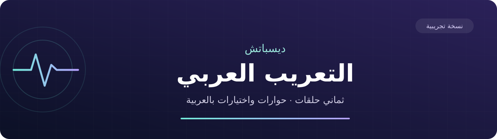

<div dir="rtl" align="center">



# ديسباتش — التعريب العربي

**الحكاية بالعربية. قراراتك كما هي.**

تعريب الحوارات والاختيارات للحلقات الثماني، مع دعم الخط العربي وعرض الترجمة من اليمين إلى اليسار.

### [⬇️ تحميل التعريب](https://github.com/exelight7/Dispatch_AR/releases/tag/v0.1.0-experimental) · [📖 طريقة التركيب](docs/التركيب.md) · [💬 الإبلاغ عن مشكلة](https://github.com/exelight7/Dispatch_AR/issues/new)

**نسخة تجريبية · تحديث ٢٨ أكتوبر ٢٠٢٦ · للحاسب بنظام ويندوز**

**مفتوح المصدر** · [المساهمة في الترجمة](CONTRIBUTING.md) · [دليل البناء والتطوير](docs/المصدر_والبناء.md)

</div>

---

<div dir="rtl">

## ماذا تتضمن الحزمة؟

| المحتوى | التفاصيل |
|:---|:---|
| الحوارات والاختيارات | تعريب نصوص الحلقات الثماني والموارد المشتركة |
| المراجعة اللغوية | مراجعة جميع سجلات الحوار والاختيارات والتسجيلات الصوتية البالغ عددها **٨٬٣٦٩** سجلًا |
| أحدث التصحيحات | **٥٢ تصحيحًا** إضافيًا في الإملاء والنحو والصياغة والمعنى |
| الخط والعرض | حزمة الخط العربي وحزمة عرض الترجمة العربية |
| الإعدادات | تبقى قوائم الإعدادات وأسماء مفاتيح التحكم **بالإنجليزية** في هذه النسخة |
| الملفات الأصلية | يُضاف التعريب في ثلاث حزم منفصلة؛ لا يستبدل حزم اللعبة الأصلية |

تضم حزمة النصوص **١٢٬٩٧٣ مدخلًا** إجمالًا، بما فيها المصطلحات والرموز والإعدادات التي تُحفظ بلغتها الأصلية. لا يشمل هذا العدد صورًا أو دبلجة عربية.

## التحميل

حمّل ملف **`Dispatch_AR_2026-10-28.zip`** من [صفحة الإصدار](https://github.com/exelight7/Dispatch_AR/releases/tag/v0.1.0-experimental).

**[⬇️ رابط التحميل المباشر](https://github.com/exelight7/Dispatch_AR/releases/download/v0.1.0-experimental/Dispatch_AR_2026-10-28.zip)**

يوجد أيضًا [رابط بديل للحزمة](https://github.com/exelight7/Dispatch_AR/raw/refs/heads/main/downloads/Dispatch_AR_2026-10-28.zip) داخل المستودع. لا تحتاج إلى تنزيل ملفات المشروع كاملة.

## التركيب في أربع خطوات

١. أغلق اللعبة، وفك ضغط الحزمة التي حمّلتها.

٢. افتح مجلد اللعبة من مكتبة ستيم ← خصائص اللعبة ← الملفات المثبتة ← استعراض، ثم انتقل إلى:

</div>

```text
Dispatch\Content\Paks
```

<div dir="rtl">

٣. انسخ الملفات الثلاثة الموجودة في مجلد `التعريب` إلى هذا المجلد:

</div>

```text
Dispatch_AR_Texts_P.pak
Dispatch_AR_Fonts_P.pak
Dispatch_AR_R8b_P.pak
```

<div dir="rtl">

٤. في خصائص اللعبة على ستيم ← عام ← خيارات التشغيل، أضف الأمر التالي مرة واحدة، مع الاحتفاظ بأي أوامر موجودة:

</div>

```text
-culture=ar
```

<div dir="rtl">

فعّل الترجمة النصية من إعدادات اللعبة إذا كانت معطلة. التفاصيل وطريقة التحديث والإزالة موجودة في **[دليل التركيب](docs/التركيب.md)**.

> **عند التحديث:** احتفظ بنسخة من ملفات التعريب القديمة قبل استبدالها. لا تحذف أي ملف يبدأ اسمه بـ `pakchunk`، ولا تنسخ أي حزمة قديمة أخرى من تجارب المشروع.

## التوافق والحالة الحالية

- أُعدت هذه النسخة لإصدار اللعبة **١٫٠٫١٩٥١٢**، وبناء ستيم **٢٥٦٣٧٧١١**. التوافق مع تحديثات أخرى غير مثبت.
- هذه نسخة تجريبية. نجحت فحوص ملفات النصوص والحزمة، ورُكبت الملفات على جهاز العمل مع التحقق من بصماتها.
- النسخة الحالية من حركة ظهور الكلمات العربية تحتاج إلى تحقق بصري إضافي؛ لا نعد بأن العرض مثالي في جميع المشاهد أو أحجام الخط.
- لم تُشغّل اللعبة بعد آخر مراجعة لغوية. لا تُعد سلامة الملفات دليلًا على خلو كل مشهد من مشاكل العرض.

## أحدث المستجدات

**٢٨ أكتوبر ٢٠٢٦**

- قراءة جميع الحوارات والاختيارات والتسجيلات الصوتية ضمن نطاق المراجعة.
- تصحيح ٥٢ موضعًا إضافيًا، مع حفظ الوسوم وفواصل توقيت الحوار.
- الإبقاء على الإعدادات وأسماء مفاتيح التحكم بالإنجليزية.
- جمع حزم النصوص والخط والعرض في تحميل واحد.

للتفاصيل: [سجل التحديثات](docs/التحديثات.md) · [تقرير المراجعة قبل وبعد](docs/مراجعة_الحوارات.md).

## واجهت مشكلة؟

[افتح بلاغًا](https://github.com/exelight7/Dispatch_AR/issues/new) وأرفق اسم الحلقة، والنص الذي ظهر، ووصف المشكلة، وصورة إن أمكن. اذكر إصدار اللعبة والتعديلات الأخرى المركبة لتسهيل التحقق.

## المصدر والترجمة والمساهمة

المستودع يضم ملفات الترجمة القابلة للتعديل، والنصوص المرجعية وبيانات الربط، والمسرد، وسجلات المراجعة، وأدوات البناء والتحقق، ومصادر إصلاح الخط والعرض، وتقارير العمل والتجارب النصية.

**[⬇️ تحميل جميع ملفات المصدر](https://github.com/exelight7/Dispatch_AR/archive/refs/heads/main.zip)** · **[نتائج فحص نسخة المصدر](docs/حالة_المصدر.md)**

| المجلد | ما ستجده فيه |
|:---|:---|
| [`translation/arabic`](translation/arabic) | ملفات الترجمة العربية المعتمدة للتعديل |
| [`translation/source`](translation/source) و[`translation/records`](translation/records) | المرجع الإنجليزي والمفاتيح والسياق والنسخة المدمجة |
| [`translation/review`](translation/review) | سجلات المراجعات والتصحيحات قبل وبعد |
| [`scripts`](scripts) | التحقق وتجميع النصوص وبناء الحزم والتركيب |
| [`tools`](tools) | أدوات التحليل ومصادر تعديل الخط والكشف العربي واختباراته |
| [`reports`](reports) و[`work`](work) | التقارير الفنية وسجلات عمل المراجعات والتجارب |
| [`tests`](tests) و[`compatibility`](compatibility) | حالات الاختبار وبيانات إصدار اللعبة المدعوم |

يمكنك تعديل الترجمة أو تطوير الأدوات وإرسال مساهمتك. ابدأ من **[دليل المساهمة](CONTRIBUTING.md)** و**[دليل المصدر والبناء](docs/المصدر_والبناء.md)**. الصفحات الرئيسية بالعربية؛ يحتفظ الأرشيف الفني بلغته الأصلية ومصطلحاته للحفاظ على تفاصيل العمل.

المفاتيح الخاصة والملفات التنفيذية والأصول الأصلية للعبة وملفات الحفظ والنسخ الاحتياطية المحلية غير منشورة. تحتاج بعض مراحل البناء إلى ملفات تستخرجها محليًا من نسختك من اللعبة؛ لا تُعدّ تقارير التجارب وصفة لبناء كل المراحل بأمر واحد.

## الحقوق

هذا مشروع تعريب مجتمعي غير رسمي، وغير تابع لمطوّر اللعبة أو ناشرها. تحتاج إلى نسخة من اللعبة لاستخدامه. تبقى حقوق اللعبة وأصولها وعلاماتها لأصحابها؛ ترخيص المستودع لا يمنح حقوقًا في أصول اللعبة.

**[الترخيص الأصلي](LICENSE)** · **[توضيح الحقوق بالعربية](docs/الحقوق.md)**

</div>
